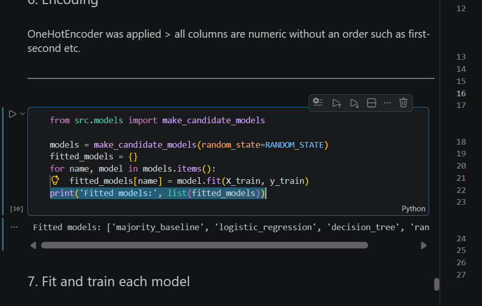

#1. Import data and libraries.

#2. Train/test split > use the 80/20 convention (I prefer 70/30) > split before learned preprocessing so the model cannot learn statistics from the testing set > data leakage. I decided to split before writing down my understanding of the data because it is more logical that code should follow the order of thinking.

   Only the training/development data is used for learned or distribution-dependent steps. The test set stays frozen until prediction and final evaluation.

#3. Context and understand the dataset > state what one row means, define the target and positive class, understand every column, prove the schema, and explain the assertions.

#4. Clean the data > check duplicates and null values. Duplicates can give one observation artificial weight in the mean, mode, variance, and standard deviation. Imputation values must be learned from training data only.

#5. Scale/normalise > categorical columns & detect outliers with IQR and z-score > inspect both methods and remove only actual errors. A very large loan may be a real and important risk signal; removing it could make the model less realistic.
- Check contradictions and inefficiencies > validate domain ranges and categorical codes, then transform categorical variables with one-hot or justified ordinal encoding.
- Visualise data

#6. Encoding so the models can read.

#7. Fit & train encoded datasets. > Important to save a new dataset each time an edit is made.

#8. Predict on test data & interpret results.

#9. Iterate to make them better.

13. Conclude and present > explain the result in natural language, limitations, governance, business meaning, and next steps.

14. Github upload?

15. Before that, there is a lot more.