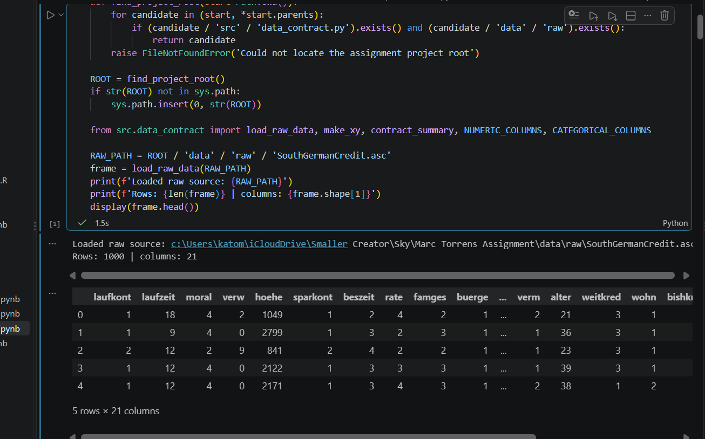

To preview the md file, in VS code; CTRL + SHIFT + V.

First results are shown then explanation. (paper in neuorscience; "Questions are the answer"). 
Example; 

For the reader it is advised to to open in parralel "plan.md" as the execution follows the plan step by step.
