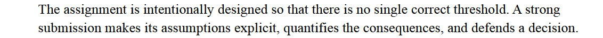

Tier 1
- 

<h4>Decision-making formula and action plan</h4>

<strong>Scenario net policy value</strong> = sum over reviewed applications of [p_bad × review effectiveness × LGD - review cost - (1 - p_bad) × abandonment rate × contribution] - (all applications × model-running cost).

Here <strong>p_bad</strong> is the model's uncalibrated score for the historical bad-risk label, used for ranking. It is not an observed 12-month default probability. Calibrate and prospectively validate it before using this formula for monetary decisions.

At fixed capacity, rank applications by expected value and select the highest-scoring 20%. The current policy is exact top-20% human review; it is not automatic approval or rejection.

Alternative policies are a lower threshold for higher recall, a higher threshold for higher precision, an expected-value threshold, or segmented thresholds where governance supports them. A lower-threshold option must expand capacity or be re-optimised under the 1,600-review limit.

Before rollout, measure electricity, compute, cybersecurity and storage costs. Use the model as a supplement to human reviewers. RAG may support policy and case-document retrieval; LLM fine-tuning should wait until enough reviewed text exists and its benefit is tested.

- What information is missing question

Suggested decision formula:

`Scenario net policy value = sum(review: p_bad × review effectiveness × LGD - review cost - (1 - p_bad) × abandonment rate × contribution) - all-applications × model-running cost.`

Which results in 

### Further code explanation

1. Assert frame differs from previous course content - suggested by LLMs - it means;  “stop if this assumption is false.” For example, assert frame.shape == (1000, 21) checks that the expected 1,000 rows and 21 columns were loaded. 

### Others

2. Column 20 credit-risk historical can do min max scaling

3. Further code understanding & simplification > from previous course content > especially steps from encoding

4. 

5. Slides improvement recommendations by AI > highest 20% risk defaults?

6. 
<strong>Correction:</strong> the original 100-review calculation means 60 TP plus 40 FP; the phrase "100 applicants selected for human review (TP)" should not be read as 100 TP.

7.